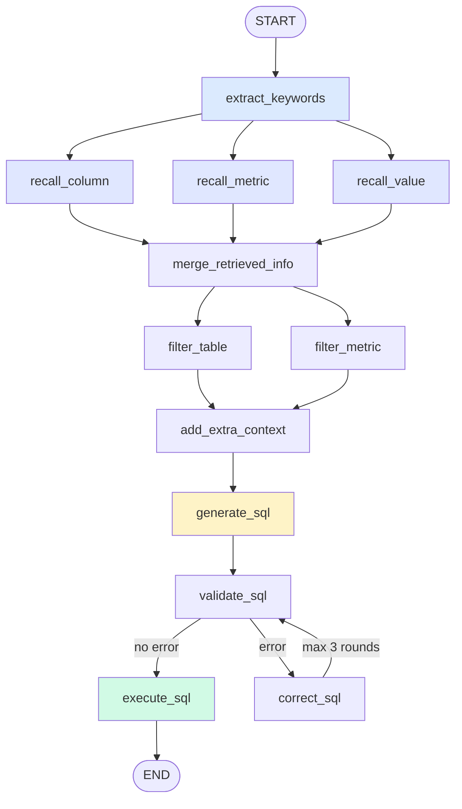

<div align="center">

# Zhanggui Wenshu

**Ask in plain language, get SQL and results back.**

An NL2SQL data Q&A agent built on LangGraph · Metadata Knowledge Base · Streaming progress over SSE

**English** · [简体中文](./README.zh-CN.md)

[](https://www.python.org/)
[](https://fastapi.tiangolo.com/)
[](https://langchain-ai.github.io/langgraph/)
[](https://vuejs.org/)
[](https://www.mysql.com/)
[](https://qdrant.tech/)
[](https://www.elastic.co/)
[](#-metadata-knowledge-base)
[](#-agent-workflow)

</div>

---

## 📖 Overview

**Zhanggui Wenshu** is an NL2SQL agent for data analytics. You ask a question in natural language (e.g. *"total sales by region over the last week"*), and the system runs the full pipeline — **keyword extraction → multi-path retrieval → info merge → SQL generation → validation → correction → execution** — streaming each step back to the client over SSE.

Rather than dumping the whole schema into the prompt, this project builds a **metadata knowledge base** (column semantics + vector index + full-text index) so the LLM retrieves only the relevant tables, columns, metrics, and enum values before writing SQL. This meaningfully improves accuracy on real business queries.

### ✨ Highlights

| Feature | Description |
|---|---|
| 🧠 **12-node agent workflow** | LangGraph state machine with parallel retrieval, conditional branching, and correction loops |
| 📚 **Metadata knowledge base** | Three stores working together: MySQL (structured), Qdrant (semantic vectors), Elasticsearch (full-text) |
| 🔍 **Multi-path retrieval** | Columns, metrics, and cell values retrieved in parallel — none blocks the others |
| 🔄 **Self-correcting SQL** | Failed validation loops back for correction, guarded by a max-round limit |
| ⚡ **End-to-end streaming** | Every node's progress is pushed over SSE and rendered incrementally by the frontend |
| 🎮 **Pixel-art frontend** | A retro 16-bit pixel UI built with Vue 3 — nostalgic yet usable |
| 🏗 **Layered architecture** | API / Service / Agent / Repository decoupled, with Mappers isolating entities from ORM models |

---

## 🏗 Architecture

```
┌──────────────────────────────────────────────────────────────────┐
│                      Frontend (Vue 3 + Vite)                     │
│              Pixel UI · SSE streaming · Table rendering          │
└───────────────────────────┬──────────────────────────────────────┘
                            │ HTTP POST /api/query  (text/event-stream)
┌───────────────────────────▼──────────────────────────────────────┐
│                        API Layer (FastAPI)                       │
│    query_router · dependencies · lifespan · request_id middleware │
└───────────────────────────┬──────────────────────────────────────┘
                            │
┌───────────────────────────▼──────────────────────────────────────┐
│                     Service Layer (orchestration)                │
│      QueryService (Q&A)  │  MetaKnowledgeService (KB building)   │
└───────────────────────────┬──────────────────────────────────────┘
                            │
┌───────────────────────────▼──────────────────────────────────────┐
│           Agent Layer (LangGraph state machine · 12 nodes)       │
│     State (flowing data) + Context (static deps) + stream_writer  │
└───────────────────────────┬──────────────────────────────────────┘
                            │
┌───────────────────────────▼──────────────────────────────────────┐
│                     Repository Layer (persistence)               │
├──────────────┬──────────────┬──────────────┬─────────────────────┤
│  MySQL/meta  │  MySQL/dw    │   Qdrant     │   Elasticsearch     │
│  metadata    │  warehouse   │  vector idx  │  full-text idx      │
│  tables/cols │  business    │  cols/metrics│  enum values        │
└──────────────┴──────────────┴──────────────┴─────────────────────┘
```

---

## 🤖 Agent Workflow

A directed graph of 12 nodes supporting **parallel retrieval** and a **conditional correction loop**:



### Node responsibilities

| Node | Responsibility |
|---|---|
| `extract_keywords` | Extract noun keywords with jieba to seed downstream retrieval |
| `recall_column` | LLM-expand column keywords → vector search Qdrant → retrieve relevant columns |
| `recall_metric` | LLM-expand metric keywords → vector search Qdrant → retrieve relevant metrics |
| `recall_value` | Full-text search ES → retrieve enum values (enables `WHERE col = 'value'`) |
| `merge_retrieved_info` | Merge all three paths, dedupe, attach values to column examples, group by table, fill in PK/FK columns |
| `filter_table` | LLM filters down to the genuinely relevant tables |
| `filter_metric` | LLM filters down to the genuinely relevant metrics |
| `add_extra_context` | Inject current date/weekday/quarter plus DB dialect and version |
| `generate_sql` | Assemble the context prompt and call the LLM to produce SQL |
| `validate_sql` | Validate the SQL and emit an `error` field |
| `correct_sql` | Ask the LLM to fix the SQL based on the error (guarded by `MAX_CORRECT`) |
| `execute_sql` | Run the SQL against the warehouse and push the result table via `stream_writer` |

> **Loop guard**: `validate_sql ↔ correct_sql` runs at most 3 times (`MAX_CORRECT = 3`), after which execution is forced — preventing an infinite loop.

---

## 🛠 Tech Stack

| Category | Technology | Version | Purpose |
|---|---|---|---|
| Language | Python | 3.13+ | — |
| Web | FastAPI | 0.128.0 | HTTP API + SSE streaming |
| Agent | LangGraph | 1.0.7 | State machine orchestration |
| LLM framework | LangChain | 1.2.7 | Prompts / parsers / chains |
| LLM | DeepSeek | — | Keyword expansion, SQL generation & correction |
| Embeddings | BAAI/bge-large-zh-v1.5 | 1024-dim | Chinese column/metric vectorization |
| ORM | SQLAlchemy | 2.0.46 | Async ORM (asyncmy driver) |
| Vector DB | Qdrant | 1.16.2 | Semantic search over columns & metrics |
| Search | Elasticsearch | 8.x | Full-text search over enum values (IK analyzer) |
| Tokenizer | jieba | 0.42.1 | Query keyword extraction |
| Config | OmegaConf | 2.3.0 | Structured config management |
| Logging | Loguru | 0.7.3 | Structured logs with request_id |
| Frontend | Vue 3 + Vite | 3.5 / 7.2 | Pixel-art chat UI |
| Deps | uv | — | Fast install & lockfile |

---

## 📁 Project Layout

```
zhanggui-wenshu/
├─ app/
│  ├─ agent/                    # 🤖 LangGraph agent
│  │  ├─ graph.py               #   graph assembly & compile
│  │  ├─ state.py               #   graph state (flowing data)
│  │  ├─ context.py             #   runtime context (static deps)
│  │  ├─ llm.py                 #   LLM instance
│  │  └─ nodes/                 #   12 nodes
│  │
│  ├─ api/                      # 🌐 FastAPI layer
│  │  ├─ routers/query_router.py
│  │  ├─ schemas/query_schema.py
│  │  └─ dependencies.py        #   DI
│  │
│  ├─ services/                 # 🧩 Business orchestration
│  │  ├─ query_service.py       #   Q&A pipeline
│  │  └─ meta_knowledge_service.py  # KB building
│  │
│  ├─ repositories/             # 💾 Persistence
│  │  ├─ mysql/meta/            #   metadata DB (incl. ORM models/)
│  │  ├─ mysql/dw/              #   warehouse queries
│  │  ├─ qdrant/                #   column/metric vector store
│  │  └─ es/                    #   value full-text index
│  │
│  ├─ entities/                 # business entities (dataclass)
│  ├─ mappers/                  # entity ↔ ORM conversion
│  ├─ clients/                  # MySQL/ES/Qdrant/Embedding client managers
│  ├─ conf/                     # config loading (OmegaConf)
│  ├─ core/                     # logging / context vars / lifespan
│  └─ scripts/
│     └─ build_meta_knowledge.py  # KB build entry script
│
├─ prompts/                     # 📝 prompt templates (7 .prompt files)
├─ prompt/prompt_loader.py      #    prompt loader
├─ conf/app_config.example.yaml # ⚙️ config template
├─ docker/docker-compose.yaml   # 🐳 Qdrant / ES / Kibana / Embedding
├─ data-agent-fronted/          # 🎮 pixel-art frontend (Vue 3 + Vite)
└─ main.py                      # FastAPI entry point
```

---

## 🚀 Quick Start

### Prerequisites

- **Python 3.13+**
- **[uv](https://docs.astral.sh/uv/)** package manager
- **Docker Desktop** (for Qdrant / Elasticsearch / Embedding)
- **MySQL 8.0** (metadata DB + warehouse — install separately)
- **Node.js 18+** (frontend)

### 1. Install dependencies

```bash
git clone https://github.com/xxxlsls/data-agent.git
cd data-agent
uv sync
```

### 2. Start infrastructure

```bash
docker compose -f docker/docker-compose.yaml up -d
```

> ⏳ The embedding service (text-embeddings-inference) takes **50–90 s** to warm up. Wait for `"Ready"` in its logs.

### 3. Configure

```bash
cp conf/app_config.example.yaml conf/app_config.yaml
```

Edit `conf/app_config.yaml` with your MySQL password and LLM API key:

```yaml
db_meta:  { host: 127.0.0.1, port: 3306, user: root, password: <your-password>, database: meta }
db_dw:    { host: 127.0.0.1, port: 3306, user: root, password: <your-password>, database: dw }
llm:      { model_name: deepseek-flash, api_key: <your-key>, base_url: https://api.deepseek.com }
```

### 4. Build the metadata knowledge base

```bash
python -m app.scripts.build_meta_knowledge -c app/conf/meta_config.yaml
```

This script:
1. Reads table/column/metric definitions from `app/conf/meta_config.yaml`
2. Queries column types and sample values from the warehouse
3. Writes to MySQL (metadata), Qdrant (vectors), and Elasticsearch (full-text)

The script is **re-runnable** — it clears the previous build first.

### 5. Start the backend

```bash
fastapi dev
# or
uvicorn main:app --reload
```

Serving at http://127.0.0.1:8000 · API docs at http://127.0.0.1:8000/docs

### 6. Start the frontend

```bash
cd data-agent-fronted
npm install
npm run dev
```

Open http://localhost:5173 .

---

## 📡 API

### `POST /api/query`

Returns the agent's progress and query result as an SSE stream.

**Request**

```json
{ "query": "total sales by region over the last week" }
```

**Response** (`text/event-stream`, pushed incrementally)

```jsonc
// 1. progress events — running / success / error per node
data: {"type":"progress","step":"提取关键词","status":"running"}
data: {"type":"progress","step":"提取关键词","status":"success"}

// 2. result event — the result table
data: {"type":"result","data":[{"地区":"华东","销售额":123456}]}

// 3. error event
data: {"type":"error","message":"..."}
```

**Try it with curl**

```bash
curl -N -X POST http://127.0.0.1:8000/api/query \
  -H "Content-Type: application/json" \
  -d '{"query":"订单量统计"}'
```

---

## ⚙️ Metadata Knowledge Base

The knowledge base is what makes NL2SQL accurate. It combines hand-written business semantics with machine-searchable indexes.

**Config entry point**: `app/conf/meta_config.yaml`

```yaml
tables:
  - name: fact_order
    role: fact
    description: Order fact table recording the details of each order.
    columns:
      - name: order_amount
        role: measure
        description: Order amount.
        alias: [sales, order amount, revenue]
        sync: false        # whether to sync this column's values into ES

metrics:
  - name: GMV
    description: Gross merchandise value.
    relevant_columns: [fact_order.order_amount]
    alias: [gross sales, total transaction value]
```

**How the three stores divide the work**

| Store | Indexes | Retrieval | Problem it solves |
|---|---|---|---|
| MySQL `meta` | Tables / columns / metrics / relations | Exact lookup | Authoritative structured metadata |
| Qdrant | Column & metric **name + description + aliases** | Vector similarity (threshold 0.6) | "what the user said" → "the actual column" |
| Elasticsearch | Column **enum values** | Full-text search (IK analyzer) | Where the value in `WHERE region = 'East'` comes from |

---

## ⚠️ Known Limitations

- **The sample warehouse data spans 2025-01 to 2025-03.** Asking about "the last week" returns an empty result because the date ranges don't overlap. Use questions within that range when testing, e.g. `statistics for January 2025`.
- **Tables must be created manually** — the project does not use `create_all`.
- **No automated tests yet.**
- **If a system proxy is enabled locally**, httpx/requests will route even `127.0.0.1` calls through it, causing 502s. Set this before running:
  ```bash
  export NO_PROXY=127.0.0.1,localhost
  ```

---

## 🤝 Contributing

Issues and PRs are welcome. Please follow the `feat:` / `fix:` / `chore:` commit convention with a Chinese description.

---

<div align="center">

**If this project helps you, consider giving it a ⭐ Star!**

</div>
