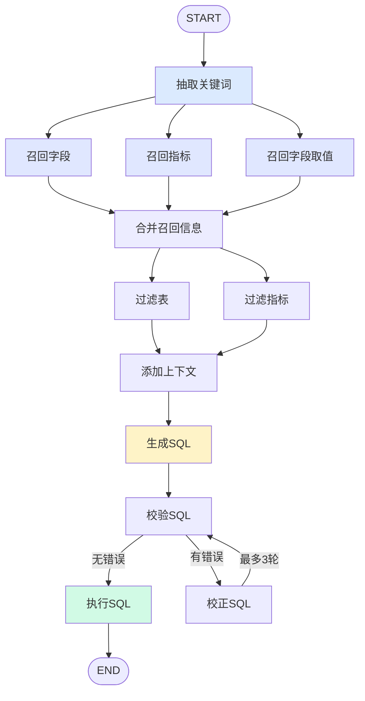

<div align="center">

# 掌柜问数

**用一句话问数，自动生成 SQL 并返回结果**

基于 LangGraph 的 NL2SQL 数据问答智能体 · 元数据知识库 · 流式进度回传

[English](./README.md) · **简体中文**

[](https://www.python.org/)
[](https://fastapi.tiangolo.com/)
[](https://langchain-ai.github.io/langgraph/)
[](https://vuejs.org/)
[](https://www.mysql.com/)
[](https://qdrant.tech/)
[](https://www.elastic.co/)
[](#-元数据知识库)
[](#-智能体工作流)

</div>

---

## 📖 项目简介

**掌柜问数** 是一个面向数据分析场景的 NL2SQL 智能体。用户用自然语言提问（如"统计最近一周各地区的销售额"），系统自动完成 **关键词抽取 → 多路召回 → 信息融合 → 生成 SQL → 校验/校正 → 执行** 的完整链路，并通过 SSE 实时回传每一步进度。

不同于"一次性把 schema 塞给大模型生成 SQL"的做法，本项目构建了一套 **元数据知识库**（字段语义 + 向量索引 + 全文索引），让 LLM 在生成 SQL 前能精准检索到相关的表、字段、指标和枚举值，显著提升复杂业务查询的准确率。

### ✨ 核心特性

| 特性 | 说明 |
|---|---|
| 🧠 **12 节点智能体工作流** | 基于 LangGraph 的状态机，支持并行召回、条件分支、回环校正 |
| 📚 **元数据知识库** | 三类存储协同：MySQL（结构化）、Qdrant（语义向量）、Elasticsearch（全文索引） |
| 🔍 **多路召回** | 字段 / 指标 / 字段取值三路并行检索，互不阻塞 |
| 🔄 **SQL 自校正** | 校验失败自动回环修正，带最大轮数保护，杜绝死循环 |
| ⚡ **全链路流式** | 每个节点的执行进度通过 SSE 实时推送，前端逐条渲染 |
| 🎮 **像素风前端** | Vue 3 打造的复古 16bit 像素界面，兼具复古与可用性 |
| 🏗 **分层架构** | API / Service / Agent / Repository 四层解耦，Mapper 隔离实体与 ORM |

---

## 🏗 系统架构

```
┌──────────────────────────────────────────────────────────────────┐
│                         前端 (Vue 3 + Vite)                       │
│                    像素风 UI · SSE 流式渲染 · 表格展示              │
└───────────────────────────┬──────────────────────────────────────┘
                            │ HTTP POST /api/query  (text/event-stream)
┌───────────────────────────▼──────────────────────────────────────┐
│                     API 层 (FastAPI)                              │
│   query_router · dependencies · lifespan · request_id 中间件       │
└───────────────────────────┬──────────────────────────────────────┘
                            │
┌───────────────────────────▼──────────────────────────────────────┐
│                    Service 层 (业务编排)                          │
│     QueryService (问答)  │  MetaKnowledgeService (知识库构建)      │
└───────────────────────────┬──────────────────────────────────────┘
                            │
┌───────────────────────────▼──────────────────────────────────────┐
│              Agent 层 (LangGraph 状态机 · 12 节点)                 │
│   State(流动数据) + Context(静态依赖) + Runtime(stream_writer)      │
└───────────────────────────┬──────────────────────────────────────┘
                            │
┌───────────────────────────▼──────────────────────────────────────┐
│                    Repository 层 (持久化)                         │
├──────────────┬──────────────┬──────────────┬─────────────────────┤
│  MySQL/meta  │  MySQL/dw    │   Qdrant     │   Elasticsearch     │
│  元数据       │  数仓         │   向量索引    │   全文索引           │
│  表/字段/指标 │  业务数据     │  字段+指标    │   字段枚举值         │
└──────────────┴──────────────┴──────────────┴─────────────────────┘
```

---

## 🤖 智能体工作流

12 个节点组成的有向图，支持**并行召回**与**条件回环**：



### 节点职责

| 节点 | 职责 |
|---|---|
| `extract_keywords` | 用 jieba 分词抽取名词关键词，作为后续召回的查询词 |
| `recall_column` | LLM 扩展字段关键词 → 向量检索 Qdrant → 召回相关字段 |
| `recall_metric` | LLM 扩展指标关键词 → 向量检索 Qdrant → 召回相关指标 |
| `recall_value` | 关键词全文检索 ES → 召回字段枚举值（解决 `WHERE 字段='值'`） |
| `merge_retrieved_info` | 合并三路召回，去重并把枚举值补充进字段示例，按表分组，补齐主外键 |
| `filter_table` | LLM 过滤出真正相关的表 |
| `filter_metric` | LLM 过滤出真正相关的指标 |
| `add_extra_context` | 注入当前日期/星期/季度 + 数据库方言与版本 |
| `generate_sql` | 组装上下文提示词，调用 LLM 生成 SQL |
| `validate_sql` | 校验 SQL 是否能被解析执行，产出 `error` 字段 |
| `correct_sql` | 依据错误信息让 LLM 修正 SQL（受 `MAX_CORRECT` 保护） |
| `execute_sql` | 在数仓执行 SQL，通过 `stream_writer` 推送结果表格 |

> **回环保护**：`validate_sql ↔ correct_sql` 最多循环 3 次（`MAX_CORRECT = 3`），超限强制执行，避免无限循环。

---

## 🛠 技术栈

| 分类 | 技术 | 版本 | 用途 |
|---|---|---|---|
| 语言 | Python | 3.13+ | — |
| Web 框架 | FastAPI | 0.128.0 | HTTP 接口 + SSE 流式响应 |
| 智能体 | LangGraph | 1.0.7 | 状态机编排 |
| LLM 框架 | LangChain | 1.2.7 | 提示词 / 输出解析 / 链路组合 |
| 大模型 | DeepSeek | — | 关键词扩展、SQL 生成与校正 |
| 嵌入模型 | BAAI/bge-large-zh-v1.5 | 1024 维 | 中文字段/指标向量化 |
| ORM | SQLAlchemy | 2.0.46 | 异步 ORM（asyncmy 驱动） |
| 向量库 | Qdrant | 1.16.2 | 字段与指标的语义检索 |
| 搜索引擎 | Elasticsearch | 8.x | 字段枚举值全文检索（IK 分词） |
| 分词 | jieba | 0.42.1 | 查询关键词抽取 |
| 配置 | OmegaConf | 2.3.0 | 结构化配置管理 |
| 日志 | Loguru | 0.7.3 | 带 request_id 的结构化日志 |
| 前端 | Vue 3 + Vite | 3.5 / 7.2 | 像素风对话界面 |
| 依赖管理 | uv | — | 极速安装与锁定 |

---

## 📁 项目结构

```
掌柜问数/
├─ app/
│  ├─ agent/                    # 🤖 LangGraph 智能体
│  │  ├─ graph.py               #   图的组装与编译
│  │  ├─ state.py               #   图状态定义（流动数据）
│  │  ├─ context.py             #   运行上下文（静态依赖）
│  │  ├─ llm.py                 #   LLM 实例
│  │  └─ nodes/                 #   12 个节点
│  │
│  ├─ api/                      # 🌐 FastAPI 接口层
│  │  ├─ routers/query_router.py
│  │  ├─ schemas/query_schema.py
│  │  └─ dependencies.py        #   依赖注入
│  │
│  ├─ services/                 # 🧩 业务编排层
│  │  ├─ query_service.py       #   问答主流程
│  │  └─ meta_knowledge_service.py  # 知识库构建
│  │
│  ├─ repositories/             # 💾 持久化层
│  │  ├─ mysql/meta/            #   元数据库（含 ORM models/）
│  │  ├─ mysql/dw/              #   数仓查询
│  │  ├─ qdrant/                #   字段/指标向量库
│  │  └─ es/                    #   字段取值全文索引
│  │
│  ├─ entities/                 # 业务实体（dataclass）
│  ├─ mappers/                  # 实体 ↔ ORM 转换
│  ├─ clients/                  # MySQL/ES/Qdrant/Embedding 客户端管理器
│  ├─ conf/                     # 配置加载（OmegaConf）
│  ├─ core/                     # 日志 / 上下文变量 / 生命周期
│  └─ scripts/
│     └─ build_meta_knowledge.py  # 知识库构建入口脚本
│
├─ prompts/                     # 📝 提示词模板（7 个 .prompt）
├─ prompt/prompt_loader.py      #    提示词加载器
├─ conf/app_config.example.yaml # ⚙️ 配置模板
├─ docker/docker-compose.yaml   # 🐳 Qdrant / ES / Kibana / Embedding
├─ data-agent-fronted/          # 🎮 像素风前端（Vue 3 + Vite）
└─ main.py                      # FastAPI 入口
```

---

## 🚀 快速开始

### 前置要求

- **Python 3.13+**
- **[uv](https://docs.astral.sh/uv/)** 包管理器
- **Docker Desktop**（用于 Qdrant / Elasticsearch / Embedding 服务）
- **MySQL 8.0**（元数据库 + 数仓，需自行安装）
- **Node.js 18+**（前端）

### 1. 安装依赖

```bash
git clone https://github.com/xxxlsls/data-agent.git
cd data-agent
uv sync
```

### 2. 启动基础设施

```bash
docker compose -f docker/docker-compose.yaml up -d
```

> ⏳ Embedding 服务（text-embeddings-inference）需要 **50~90 秒** 预热模型，日志出现 `"Ready"` 后才可用。

### 3. 配置

```bash
cp conf/app_config.example.yaml conf/app_config.yaml
```

编辑 `conf/app_config.yaml`，填入 MySQL 密码和 LLM API Key：

```yaml
db_meta:  { host: 127.0.0.1, port: 3306, user: root, password: <你的密码>, database: meta }
db_dw:    { host: 127.0.0.1, port: 3306, user: root, password: <你的密码>, database: dw }
llm:      { model_name: deepseek-flash, api_key: <你的KEY>, base_url: https://api.deepseek.com }
```

### 4. 构建元数据知识库

```bash
python -m app.scripts.build_meta_knowledge -c app/conf/meta_config.yaml
```

该脚本会：
1. 读取 `app/conf/meta_config.yaml` 中的表/字段/指标定义
2. 从数仓查询字段类型与样例值
3. 写入 MySQL（元数据）、Qdrant（向量索引）、Elasticsearch（全文索引）

脚本支持**重复执行**（每次先清空再重建）。

### 5. 启动后端

```bash
fastapi dev
# 或者
uvicorn main:app --reload
```

服务运行在 http://127.0.0.1:8000 ，接口文档 http://127.0.0.1:8000/docs

### 6. 启动前端

```bash
cd data-agent-fronted
npm install
npm run dev
```

打开 http://localhost:5173 即可使用。

---

## 📡 API

### `POST /api/query`

以 SSE 流式返回智能体的执行进度与查询结果。

**请求**

```json
{ "query": "统计最近一周各地区的销售额" }
```

**响应**（`text/event-stream`，逐条推送）

```jsonc
// 1. 进度事件 —— 每个节点的 running / success / error
data: {"type":"progress","step":"提取关键词","status":"running"}
data: {"type":"progress","step":"提取关键词","status":"success"}

// 2. 结果事件 —— 查询结果表格
data: {"type":"result","data":[{"地区":"华东","销售额":123456}]}

// 3. 错误事件
data: {"type":"error","message":"..."}
```

**curl 测试**

```bash
curl -N -X POST http://127.0.0.1:8000/api/query \
  -H "Content-Type: application/json" \
  -d '{"query":"统计2025年1月的订单量"}'
```

---

## ⚙️ 元数据知识库

知识库是 NL2SQL 准确率的关键。它把"人写的业务语义"和"机器可检索的索引"结合起来。

**配置入口**：`app/conf/meta_config.yaml`

```yaml
tables:
  - name: fact_order
    role: fact
    description: 订单事实表，记录每笔订单的交易明细。
    columns:
      - name: order_amount
        role: measure
        description: 订单金额。
        alias: [销售额, 订单金额, 收入]
        sync: false        # 是否把该字段的枚举值同步到 ES

metrics:
  - name: GMV
    description: 商品交易总额。
    relevant_columns: [fact_order.order_amount]
    alias: [成交额, 交易总额]
```

**三类存储的分工**

| 存储 | 索引对象 | 检索方式 | 解决什么问题 |
|---|---|---|---|
| MySQL `meta` | 表 / 字段 / 指标 / 关联关系 | 精确查询 | 提供权威的结构化元数据 |
| Qdrant | 字段 / 指标的 **名称 + 描述 + 别名** | 向量相似度（阈值 0.6） | "用户说的词" → "库里的字段" |
| Elasticsearch | 字段的**枚举值** | 全文检索（IK 分词） | `WHERE 地区 = '华东'` 里的值从哪来 |

---

## ⚠️ 已知限制

- **示例数仓数据的时间范围是 2025-01 ~ 2025-03**。若按"最近一周"提问，会因时间范围无交集而返回空结果。测试时请使用该时间段内的问题，例如 `统计2025年1月的订单量`。
- **表结构需手工创建**，项目未使用 `create_all` 自动建表。
- **本项目暂无自动化测试**。
- **本机若开启系统代理**，httpx/requests 会把 `127.0.0.1` 的请求也走代理导致 502。运行前请设置：
  ```bash
  export NO_PROXY=127.0.0.1,localhost
  ```

---

## 🤝 贡献

欢迎提 Issue 和 PR。提交信息请遵循 `feat:` / `fix:` / `chore:` + 中文描述的格式。

---

<div align="center">

**如果这个项目对你有帮助，欢迎点个 ⭐ Star！**

</div>
